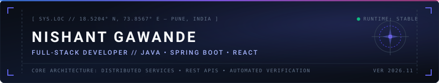

  

  

    
    
    
    
  

---

## 👨‍💻 About & Engineering Focus

I am a software developer based in Pune, India (B.E. Electronics & Telecommunication Engineering, 2025). I build production-grade web applications, RESTful services, and database-backed systems with strong architectural boundaries, transactional integrity, and automated testing discipline.

### **Engineering Focus**
* **Java & Spring Boot** backend services, microservice patterns, and relational data layers.
* **React** frontend interfaces built with modern toolchains (Vite, Tailwind CSS).
* **REST API** contract design, documentation, and client-server integration.
* **Authentication, Authorization & Persistence**: Stateless JWT, OTP verification, RBAC, PostgreSQL, and MySQL.

---

## 🚀 Featured Project — LearnIQ

### 🌟 [LearnIQ — Modern Assessment & Examination Platform](https://github.com/Nishantsg3/LearnIQ)
**Full-Stack Examination System | Java 17 • Spring Boot 3 • React 18 • PostgreSQL • Render**  
🔗 [Live Platform](https://learniq-frontend-7oyn.onrender.com) • [REST API Documentation](https://learniq-backend-vglf.onrender.com/api/v1) • [GitHub Repository](https://github.com/Nishantsg3/LearnIQ)

**Currently Building & Maintaining:**
* **Frontend Architecture**: Modern React 18 single-page application built with Vite and Tailwind CSS. Features dark/light themes, keyboard navigation shortcuts (`A-D`, `← →`, `M`), and mobile responsiveness.
* **Backend Architecture**: Spring Boot 3.5 RESTful backend integrated with cloud-managed Neon PostgreSQL.
* **Security & Authentication**: Stateless JWT token authentication, secure OTP verification for password reset flows, and granular role-based access control (`ROLE_STUDENT`, `ROLE_ADMIN`, `ROLE_FACULTY`).
* **Assessment & Practice Workflows**: Synchronized test-taking engine with server-synced countdown timer, question palette navigation, real-time response autosave, and instant scorecard generation.
* **Diagnostic Review**: Post-submission solution audits providing question-by-question rationales, concept keys, and mistake filtering.
* **Automated Verification**: **200+ unit & integration tests** (`./mvnw test`) validating security policies, transaction boundaries, and evaluation logic.

---

## 📦 Other Selected Projects

### 🏦 [FinCore — Java Banking System](https://github.com/Nishantsg3/java-banking-system)
**Core Java • JDBC • MySQL**  
🔗 [GitHub Repository](https://github.com/Nishantsg3/java-banking-system)

* Console-based banking application implementing relational schema modeling and transactional ACID semantics.
* Implemented account creation, secure deposits, withdrawals, and balance inquiry using raw JDBC SQL queries.
* Structured with clean data access layers (DAO pattern), input validation, and defensive exception handling.

### 🧠 [Quiz Hub — Interactive Timed Quiz Application](https://github.com/Nishantsg3/Quiz-Hub)
**JavaScript • HTML5 • CSS3**  
🔗 [Live Demo](https://quiz-hub-web.netlify.app) • [GitHub Repository](https://github.com/Nishantsg3/Quiz-Hub)

* Responsive browser-based quiz application with real-time scoring and dynamic question rendering.
* Features countdown timers, score calculation logic, and responsive DOM interaction built with event-driven JavaScript.
* Deployed on Netlify with automated continuous deployment from source.

### 🛒 [Grocery Shopping System](https://github.com/Nishantsg3/grocery-shopping-system-java)
**Java • Object-Oriented Design • File I/O**  
🔗 [GitHub Repository](https://github.com/Nishantsg3/grocery-shopping-system-java)

* Console store management application demonstrating object-oriented principles (inheritance, encapsulation, polymorphism).
* Features item catalog selection, dynamic bill computation, inventory tracking, receipt generation, and persistent file-based storage.

---

## 🛠️ Technical Stack

| Category | Technologies |
| :--- | :--- |
| **Languages** |     |
| **Backend & APIs** |       |
| **Frontend** |      |
| **Databases** |    |
| **Tools & Testing** |        |

---

## 📈 Contribution Activity

<picture>
  <source media="(prefers-color-scheme: dark)" srcset="https://raw.githubusercontent.com/Nishantsg3/Nishantsg3/output/github-contribution-grid-snake-dark.svg">
  <source media="(prefers-color-scheme: light)" srcset="https://raw.githubusercontent.com/Nishantsg3/Nishantsg3/output/github-contribution-grid-snake.svg">
  
</picture>

---

## 📬 Contact & Portfolio

  
<b>Open to Entry-Level Software Developer / Java Full-Stack Developer Roles</b>

  

    <a href="https://linkedin.com/in/nishant-g3">LinkedIn</a> •
    <a href="https://portfolionsg-web.netlify.app">Portfolio</a> •
    <a href="mailto:ngawande256@gmail.com">ngawande256@gmail.com</a> •
    <a href="https://github.com/Nishantsg3">GitHub</a>
  

   

  

    
<kbd><code>⌘ // [ easter-egg.sh ]</code></kbd>

    

       
      
<i>「 常識を疑い、限界を超えて構築せよ 」</i>

      
<i>"Question convention. Build beyond limits."</i>

      <pre>
       ▲
      ▲ ▲    // Engineering Principles:
     ▲ ▲ ▲   // Architecture • Resilience • Clarity
      </pre>
      
<small><code>system_status: all 200+ test suites green • runtime nominal</code></small>

    

  

